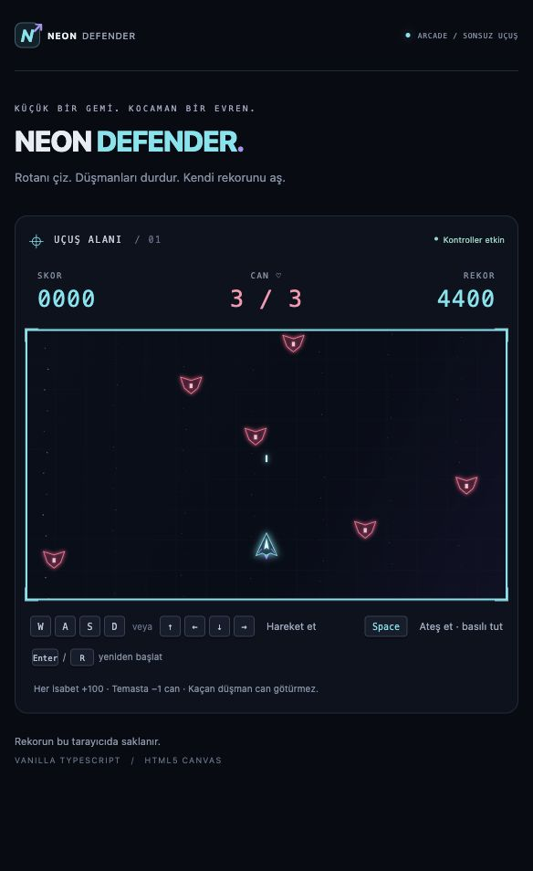
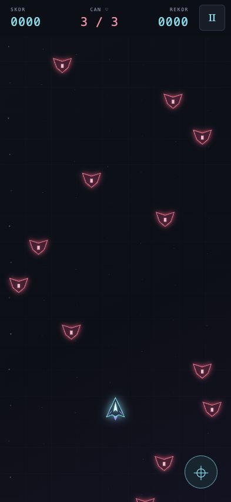

# Neon Defender

> **V2.0:** 30 görev, 3 galaksi, 6 boss, kesintisiz Endless ve arcade sesleri. Yerel testler ve iPhone 15 kullanıcı kabulü tamamlandı. [V1-V2 farkları](docs/V2_CHANGELOG.md) · [Doğrulama kaydı](docs/V2_ACCEPTANCE.md) · [Teknoloji rehberi PDF](output/pdf/neon-defender-v2-teknoloji-rehberi.pdf).

[](https://github.com/CenkCey/neon-defender/actions/workflows/ci.yml)

**Küçük bir gemi. Kocaman bir evren.**

TypeScript ve HTML5 Canvas ile geliştirilen neon temalı bir 2D uzay oyunu. Masaüstünde klavyeyle, telefonda dokunarak oynanır. Aynı kaynak kodu Capacitor ile yerel iOS uygulaması olarak da çalışır.

Oyun motoru, backend veya harici görsel paketi kullanılmaz. Gemiler, düşmanlar ve efektler Canvas üzerinde çizilir.

| Tarayıcı sürümü | Mobil tam ekran uçuş |
| :---: | :---: |
|  |  |

> Görüntüler V1 tarayıcı önizlemeleridir; V2 Campaign/boss ekranlarını göstermez. Güncel cihaz kabul kaydı aşağıdaki doğrulama belgelerindedir.

## Özellikler

- WASD / ok tuşlarıyla hareket, Space ile sürekli ateş.
- Yaklaşık 180 ms atış aralığı; delta time ile hesaplanan hareket.
- Rastgele düşmanlar, çarpışmalar, 3 can, skor ve cihazda saklanan rekor.
- Campaign için üç wave’li 30 level, sıralı açılma ve 1–3 yıldız.
- Endless için kesintisiz üretim, öldürme tabanlı tier ve her 5 tier için sıraya alınan boss karşılaşması.
- Altı düşman türü, altı boss, Shield ve 7 saniyelik Rapid Fire.
- Campaign’de skora, Endless’ta 240 normal öldürmeye kadar 280-390 birim/sn kontrollü hareket artışı. Endless atışı kademeli 180-160 ms olur.
- Boss savaşlarında en fazla iki normal düşman; her 10. yenilen boss karşılaşmasında eksikse +1 can.
- 14 kısa Web Audio efekti; kaydedilen SES AÇIK/KAPALI tercihi, tekrar/voice sınırları ve arka plan yönetimi.
- Drag & Fire ve sensör destekleniyorsa Tilt & Tap kontrolleri.
- Mobil uçuşta ekranı dolduran, oranları bozulmayan oyun alanı.
- Duraklatma, Game Over, yeniden başlatma ve menüye dönüş.
- Çevrimdışı PWA önbelleği ve uygulama içine paketlenen iOS sürümü.
- iOS uygulamasında sabit menü/oyun ekranı; çift dokunma ve pinch zoom kapalı.

## Hızlı başlangıç

**Gereksinimler:** Node.js 22.12 veya üzeri ve npm.

```sh
git clone https://github.com/CenkCey/neon-defender.git
cd neon-defender
npm ci
npm run dev
```

Terminalde gösterilen yerel adresi açın. `index.html` dosyasını doğrudan çift tıklayarak çalıştırmayın.

Üretim sürümünü yerelde denemek için:

```sh
npm run build
npm run preview
```

Mac ve Windows için sırasıyla `Oyunu-Baslat.command` ve `Oyunu-Baslat.cmd` başlatıcıları da bulunur. Terminali kapatmak veya Ctrl+C sunucuyu durdurur.

## Kontroller

| Ortam | Hareket | Ateş |
| --- | --- | --- |
| Bilgisayar | WASD veya ok tuşları | Space; sürekli ateş için basılı tut |
| Drag & Fire | Gemiye yakın yerden yatay sürükle | Sağ alttaki ateş düğmesini tut |
| Tilt & Tap | İzin ve kalibrasyon sonrası telefonu sola/sağa eğ | Oyun alanına dokun veya basılı tut |

- **Campaign / Endless:** modu seçer; Campaign’de level seçimi ve briefing sonrası başlatır.
- **Enter / R:** Game Over sonrasında mevcut uçuşu yeniden başlatır.
- **Ⅱ / Devam et:** oyunu duraklatır ve aynı uçuşa döner.
- **Menüye dön:** mevcut uçuşu bitirir; rekor saklanır.
- Odak kaybı ve uygulamanın arka plana alınması oyunu duraklatır, basılı girdileri temizler.

Mobil hareket yataydır. Eğim modu yalnızca kullanılabilir sensör verisi alındığında etkinleşir; izin reddi veya veri yokluğunda Drag & Fire kullanılır. Web sensörleri için HTTPS gerekir.

## Oyun kuralları

Scout **100 puan** kazandırır; diğer türler ve boss’lar yapılandırılmış farklı puanlar verir. Geminin düşmanla teması bir can azaltır ve ardından bir saniye koruma sağlar. Campaign’de kaçış doğrudan can azaltmaz, ancak başarı için en az %60 düşman yok edilmelidir. Endless’ta her üç kaçış bir can azaltan breach oluşturur. Üç can bitince oyun durur.

Yeniden başlatma konumları, skoru, canları, mermileri, düşmanları ve zamanlayıcıları sıfırlar. Rekor `localStorage` ile korunur. Rekor farklı cihazlar veya farklı adresler arasında eşitlenmez; depolama kullanılamıyorsa oturum boyunca bellekte tutulur.

## iPhone'da yerel uygulama

**Gereksinimler:** macOS, Xcode, Node/npm ve cihazda imzalama için kendi Apple hesabınız.

```sh
npm ci
npm run ios:sync
npm run ios:open
```

Xcode'da `ios/App/App.xcodeproj` açılır. Kendi geliştirme takımınızı seçin, iPhone'u bağlayın ve Run ile yükleyin. Swift Package Manager kullanılır; CocoaPods gerekmez. İmzalama bilgilerinizi repoya eklemeyin.

Ayrıntılar: [iOS kurulumu](IOS_KURULUM.md) · [iPhone kontrol listesi](IPHONE_TESTING.md).

Native sürüm uzak bir web sitesini yüklemez; üretim dosyaları uygulamanın içine kopyalanır. Bu repo imzalı IPA, TestFlight veya App Store dağıtımı içermez.

## Web / PWA dağıtımı

```sh
npm run build
```

`dist/` içeriğini HTTPS sunan statik bir hostinge yükleyin. Vite göreli dosya yolları üretir; build adımı manifest, ikonlar ve içerik sürümüne bağlı service worker önbelleğini hazırlar. Çalışan oyun zorla güncellenmez.

Safari'de Ana Ekran'a ekleme ve çevrimdışı kontrol adımları [kullanım rehberinde](OYUNU_AC.md) bulunur. Bu depoda herkese açık ve güncel olduğu garanti edilen bir canlı demo bağlantısı sunulmuyor.

## Geliştirme ve kontroller

```sh
npm test
npm run typecheck
npm run build
```

Testler Node'un yerleşik test aracıyla çalışır. **V1’de 84, V2’de 152 otomatik test**; hareket/FPS tutarlılığı, atış aralığı, çarpışmalar, skor/can, yeniden başlatma, depolama, mobil koordinatlar, sensör durumları ve lifecycle temizliğini kapsar. V2 testleri ayrıca 30 level ilerlemesi, tier eşikleri, boss fazları/güvenli alanları, entity sınırları ve ses açma/mute/interruption davranışını denetler.

GitHub Actions her push ve pull request üzerinde temiz bağımlılık kurulumu, test ve üretim derlemesini çalıştırır. Doğrulanan cihaz davranışları ve test sınırları [CHECKS.md](CHECKS.md) içindedir.

## Kaynak yapısı

```text
src/
  main.ts            Sayfa bağlantıları ve arayüz
  game.ts            Tek oyun döngüsü, çizim ve boyutlandırma
  world.ts           Tarayıcıdan bağımsız oyun simülasyonu
  input.ts           Klavye girdileri
  player.ts          Gemi çizimi, hareket ve sınırlar
  bullets.ts         Mermiler ve atış zamanlaması
  enemies.ts         Düşmanlar ve zorluk eğrisi
  collision.ts       Çarpışma çözümü
  effects.ts         Vuruş efektleri
  high-score.ts      Kalıcı rekor
  touch-input.ts     Ayrı hareket/ateş pointer'ları
  tilt.ts            Sensör izni ve kalibrasyon
  mobile-controls.ts Mobil kontrol seçimi
  viewport.ts        Ekrana uygun mantıksal alan
  native.ts          iOS lifecycle bağlantısı
  pwa.ts             Çevrimdışı hazırlık
  content.ts         Level, düşman, boss ve zorluk tabloları
  director.ts        Campaign wave ve Endless tier/encounter ilerlemesi
  bosses.ts          Boss hareketi, fazlar, telegraph ve saldırı planları
  projectiles.ts     Düşman/boss mermileri
  powerups.ts        Shield ve Rapid Fire
  progress.ts        V2 kayıtları, yıldız/kilitler ve V1 geçişi
  ui.ts              Menü, briefing, pause ve sonuç ekranları
  themes.ts          Galaksi palet geçişleri
  audio.ts           Sentez efektleri, açma/mute ve lifecycle
  config.ts          Oyun ayarları
  style.css          Görsel tema ve ekran düzeni
tests/               Otomatik testler
scripts/             Üretim PWA önbelleği
public/              Manifest ve uygulama ikonları
ios/                 Xcode / Swift Package Manager projesi
docs/                Sürüm/kabul/teknoloji belgeleri ve V1 ekranları
output/pdf/          V1 ve V2 teknoloji rehberleri
```

Tek `requestAnimationFrame` döngüsü giriş → hareket → atış → düşmanlar → çarpışmalar → çizim sırasını yönetir. Restart yeni döngü oluşturmaz. Masaüstü 960×540 mantıksal alan kullanır; mobil görünüm ekran oranına uyarlanır. Delta time 50 ms ile sınırlandırılır; V2 simülasyonu en fazla 1/60 sn alt adımlara bölünür. Canvas piksel yoğunluğu en fazla 2× olur.

## Ses

Settings ekranında SES AÇIK seçin (varsayılan kapalı). Efektler Web Audio API ile sentezlenir; müzik veya harici ses dosyası yoktur. İlk kullanıcı etkileşimi ses bağlamını açar. OFF devam eden sesleri de keser; tercih mevcut localStorage kaydıyla korunur. iOS sistem sesi/sessiz modu kısıtları aşılmaz.

## V2 belgeleri

- [V1-V2 değişiklikleri](docs/V2_CHANGELOG.md)
- [Teknoloji rehberi](docs/V2_TECHNOLOGY_GUIDE.md) ve [PDF sürümü](output/pdf/neon-defender-v2-teknoloji-rehberi.pdf)
- [Phase A](docs/PHASE_A.md), [Phase B](docs/PHASE_B.md), [Phase C](docs/PHASE_C.md): uygulama aşamalarının tarihsel kayıtları.
- [Kabul ve test kapsamı](docs/V2_ACCEPTANCE.md): otomatik kanıtlar ile kullanıcı cihaz onayının ayrımı.

## Katkıda bulunma

Küçük ve odaklı değişiklikler önerin. Oyun motoru, backend veya harici görsel bağımlılığı eklemeyin. Değişiklikten önce [AGENTS.md](AGENTS.md) kurallarını okuyun; testleri ve üretim derlemesini çalıştırın. Mobil davranış için gerçek cihaz testi ile tarayıcı önizlemesini ayrı belirtin.

## Lisans

Bu depoya lisans dosyası eklenmemiştir.
